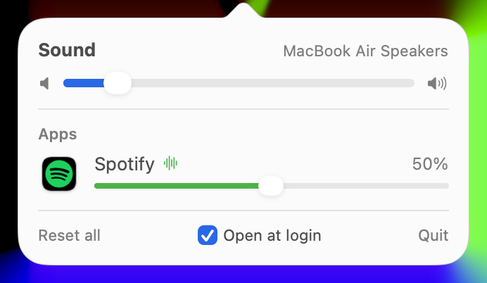

# Faders

Per-app volume for macOS, from the menu bar. Turn a game down without touching Spotify,
mute a noisy browser tab's app, and leave everything else alone.



## Install

Paste into Terminal:

```sh
curl -fsSL https://raw.githubusercontent.com/krabduke/faders/main/install.sh | zsh
```

Then:

1. Click the sliders icon in the menu bar.
2. The first time you change an app's volume, macOS asks to allow **Screen & System Audio
   Recording**. Click **Allow**. Faders needs this to route an app's sound through itself.
   It doesn't record or save anything.
3. Tick **Open at login** at the bottom of the panel so it comes back after a restart.

Needs macOS 14.2 or later. The prebuilt download is for Apple Silicon; on Intel, build
from source.

## Using it

- Every app making sound gets a row, with its slider tinted in the app's own colour.
- **Click an app's icon** to mute or unmute it.
- **Right-click a row** to put it back to 100%.
- The top slider is your normal Mac volume. Each app's volume sits on top of it.
- **Reset all** puts every app back to 100% and unmutes them.
- Volumes are remembered per app, so your game starts at the level you left it.

An app left at 100% is never touched. Faders only steps in once you move its slider.

## If something sounds wrong

- **An app went silent:** Faders probably isn't allowed to capture audio. The panel says so
  after a few seconds. Allow it in System Settings → Privacy & Security → Screen & System
  Audio Recording, then quit and reopen Faders.
- **Anything else:** click **Reset all**, or quit Faders. Every app goes straight back to
  normal macOS sound.

## How it works

For each app you turn down, Faders creates a Core Audio *process tap* (macOS 14.2+), which
captures that app's sound and mutes its normal output. It then plays the captured sound to
your current output device at the volume you chose, through a private aggregate device.
Helper processes (browser tabs, game audio engines) are grouped under the app that owns
them. When you switch speakers or headphones, the taps are rebuilt on the new device.

## Build from source

Needs the Xcode command line tools (`xcode-select --install`).

```sh
git clone https://github.com/krabduke/faders.git
cd faders
./build.sh --install
```

Every rebuild is signed ad hoc, so macOS asks for the audio permission again.
`scripts/release.sh vX.Y.Z` publishes a release for the installer.

## License

MIT
